  

  <b>Indie Software Developer &amp; Entrepreneur</b> 
  Building digital products, native iOS apps, and tools that turn ideas into reality.

  <a href="https://github.com/izesf77-ship-it/NOVAORIG">NOVA</a> &nbsp;✦&nbsp;
  <a href="https://github.com/izesf77-ship-it/VOLNA">VOLNA</a> &nbsp;✦&nbsp;
  <a href="https://github.com/izesf77-ship-it/LUNE">LUNÉ</a>

  
  
  

 

---

## 01 · ABOUT

I’m Kirill, an independent developer and entrepreneur. I like taking a product from the first rough idea through architecture, interface, code, and release.

My current work spans native iOS development, programming language design, and digital products. I care about clear interfaces, thoughtful details, and software people can actually use.

> Imagine boldly. Build carefully. Ship the thing.

---

## 02 · CURRENT PROJECTS

| PROJECT | WHAT IT IS | STATUS |
|:--|:--|:--|
| **[NOVA](https://github.com/izesf77-ship-it/NOVAORIG)** | A programming language project exploring its own syntax, type system, compiler, and developer tooling. | In development |
| **[VOLNA](https://github.com/izesf77-ship-it/VOLNA)** | A Russian-language iOS music app with radio, playback, lyrics, and a multi-source catalog. | In development |
| **[LUNÉ](https://github.com/izesf77-ship-it/LUNE)** | An offline-first iOS cycle and wellness tracker, designed around privacy and local data. | In development |
| **[visualgram](https://github.com/izesf77-ship-it/visualgram)** | A visual product built around native interface design and motion. | Exploring |
| **[Telegram tools](https://github.com/izesf77-ship-it/tg)** | Bots, integrations, and small tools for Telegram. | Ongoing |

---

## 03 · TOOLBOX

  
  
  
  
  

---

## 04 · GITHUB ACTIVITY

  
  

  

---

## 05 · EXPLORE

  

 

  
    
  IDEAS IN MOTION. PRODUCTS IN THE WORLD.

