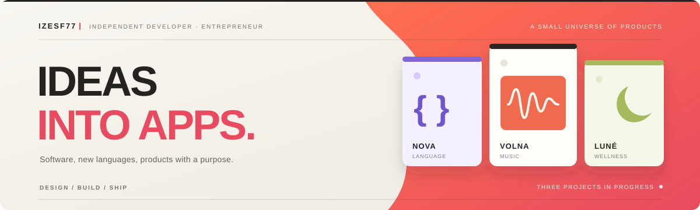

  

  <b>Independent Software Developer &amp; Entrepreneur</b> 
  Building native apps, programming languages, and digital products.

---

### WHAT I'M BUILDING

| PROJECT | THE IDEA | STACK |
|:--|:--|:--|
| **[NOVA](https://github.com/izesf77-ship-it/NOVAORIG)** | A programming language with its own syntax, type system, compiler, and tooling. | `TypeScript` · `LLVM` |
| **[VOLNA](https://github.com/izesf77-ship-it/VOLNA)** | A Russian-language music app with radio, lyrics, and a multi-source catalog. | `Swift` · `SwiftUI` |
| **[LUNÉ](https://github.com/izesf77-ship-it/LUNE)** | An offline-first cycle and wellness tracker, built around privacy and local data. | `Swift` · `SwiftUI` |
| **[visualgram](https://github.com/izesf77-ship-it/visualgram)** | A visual product shaped around native interfaces and motion. | `Swift` |
| **[Telegram tools](https://github.com/izesf77-ship-it/tg)** | Bots, integrations, and useful automations. | `Python` |

---

### TOOLS

  
  
  
  
  
  

### GITHUB ACTIVITY

  
  

  

---

  <a href="https://github.com/izesf77-ship-it?tab=repositories">Explore all projects →</a>

